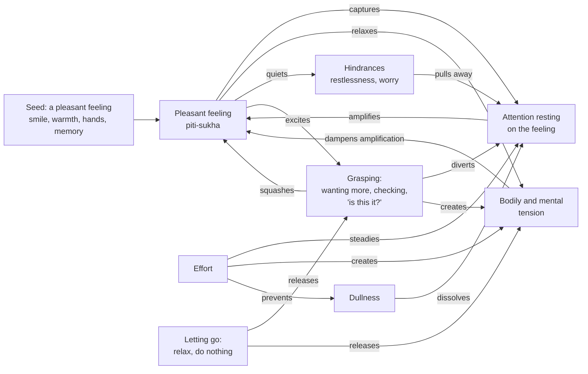

# 4. The mechanism: a causal model of the loop

This is the working theory. It is a synthesis, and it goes beyond what any single source
establishes. Each part is marked with what supports it. An executable version is in
[`src/loopModel.js`](../../src/loopModel.js), with the claims below encoded as tests in
[`tests/loopModel.test.js`](../../tests/loopModel.test.js).

## 4.1 The claim in one paragraph

First jhana is the ignition of a positive-feedback loop between **attention** and **pleasant
feeling**. Attention resting on a pleasant bodily feeling amplifies the feeling; the amplified
feeling captures attention, relaxes the body and quiets competing mental activity, which makes
attention rest there more completely. Below a threshold the feeling decays back to nothing.
Above it the loop feeds itself, runs away, and saturates: that is the take-off people describe.
What mostly decides which side of the threshold a person is on is not how much attention they
can muster. It is how much they interfere: straining, grabbing at the feeling, checking on it,
or bracing against it.

## 4.2 The loop



Two loops are reinforcing: pleasure → attention → pleasure, and pleasure → relaxation →
pleasure. Two are balancing: pleasure → grasping → less pleasure, and effort → tension → less
pleasure. Jhana happens when the reinforcing loops win.

## 4.3 The loop-gain inequality

For a small pleasant feeling, the feeling grows when

```
          (attention on the feeling)³ × (1 − tension)² × sensitivity
  gain = ───────────────────────────────────────────────────────────── > 1
                     natural fading + grasping
```

The exponents are modelling choices, not measurements. What the form is meant to capture:

- **Attention is in the numerator, and only attention that is actually on the feeling counts.**
  Checking whether it is working is attention on a thought about the feeling.
- **Continuity matters more than proportionally.** Flickering attention amplifies very little
  (the cubic term). This is the role of access concentration.
- **Tension multiplies the gain down.** A perfectly steady, strained mind has low gain.
- **Grasping is in the denominator.** It works like extra decay.
- **The gain itself rises as pleasure rises**, because pleasure captures attention and melts
  tension. This makes the system bistable: there is an ordinary state and a jhana state, with a
  threshold between them. It also gives hysteresis: once in, the state survives conditions that
  could never have started it.

## 4.4 What the model predicts, and what the sources say

| Prediction | Support | Status |
|---|---|---|
| **Sudden onset.** Growth is slow near threshold and then runs away | "Takes off" after uneven growth [B1]; builds until it "explodes" [B2]; intermediate jhana "starts with a phenomenological shift where attention locks onto the object" [S13] | Well supported by reports |
| **Self-sustaining once in** (hysteresis) | "Effortless focus" as a jhana factor trajectory [S13]; do nothing [B1]; experts hold it for minutes to hours and enter in about a second [FP3] | Supported by reports |
| **Effort has an optimum, and the optimum falls as pleasure rises** | Effort as a dimmer one must learn by overshooting and undershooting; undershoot → sleep, overshoot → headache [RB2]. Over-efforting the commonest mistake [J2] | Supported by teachers; the "falling optimum" is this project's inference |
| **Grasping at the onset collapses it**, producing repeated false starts | Grasping pushed the pleasure away [FP3]; pīti but no jhana while trying to grasp [FP7; B3 snippet]; first jhana "wobbles" as the mind grasps and releases [AB via S13] | Well supported |
| **Near threshold, a pleasant plateau** that neither grows nor fades | "Grows a little, pauses, then grows more" [B1]; people stuck with small pīti from the breath [FP12, S] | Weakly supported |
| **Attention skill alone is not sufficient** | Experienced meditators failing where novices succeed [FP6]; >1,000 h with unreliable access [FP7]; experience not predictive [J2, J5] | Supported, by a small number of accounts and provider statements |
| **Too little effort gives pleasant dullness, not jhana** | Jhana defined by clear awareness as opposed to trance or sleep [S13]; too comfortable → sloth [B1]; "flow, not relaxation" [FP1] | Supported |
| **A release step drives it** | "Attention, arousal, and release" spiral from interviews [S16]; TWIM's relax step [J4]; release of tension as lowering precision [S18] | Supported by an interview study and one theory paper |
| **Reward circuitry is involved** | Nucleus accumbens activation, n=1 [S1] | Anecdotal |
| **Slower breathing accompanies it** | Slower respiration in jhana vs breath mindfulness, n=10 [S6] | One preprint |

## 4.5 After ignition: the sequence as successive release

The later jhanas follow the same rule applied again: **let go of the coarsest thing present.**

| Step | What is released | What remains | Source |
|---|---|---|---|
| J1 → J2 | The effort of placing and holding attention; the foreground of bodily energy | Joy, with energy in the background | B2; canonical formula [SU, M] |
| J2 → J3 | Excited energy (pīti) | Contentment | B2 |
| J3 → J4 | Pleasure itself | Equanimity, stillness | B2 |
| J4 → J5–J8 | Body boundary, then object, then perception | Progressively less | B2 |

Predictive-processing accounts describe this as stepwise reduction of precision down the
hierarchy [S18, S22]. The imaging studies of adepts fit a flattening of cortical hierarchy with
depth [S4, S8, S9]. This project does not model the later jhanas in detail; the app only points
at the J1 → J2 move.

## 4.6 Triggers and breakers

| Triggers (raise gain) | Breakers (lower gain) |
|---|---|
| A seed that works for this person | No seed, or a seed that feels forced |
| 10–20 minutes of settling first | Starting on the feeling before the mind has settled |
| Physical comfort, long out-breaths, softened face | Pain; a hard posture; controlling the breath |
| Light, continuous attention on the *pleasantness* | Forced attention; attention on the idea of the feeling |
| Enjoying it on purpose | Evaluating it, measuring it, comparing it with descriptions |
| Doing nothing when it grows | Excitement, trying to increase it or hold it |
| Feeling safe; permission to feel good | Fear at the threshold; guilt; an inner critic |
| Brightness, interest | Drowsiness; too comfortable; late at night |
| Many hours with few demands (retreat) | Short sits squeezed between obligations; goal pressure |

## 4.7 What the executable model is and is not

`src/loopModel.js` has six state variables (attention, pleasure, tension, grasping, hindrance,
energy), four actions (effort, where attention is aimed, seeding, relaxing) and nine traits. Its
constants were tuned by hand so that time scales look like reports: about ten minutes to settle,
a few minutes from locking on to take-off.

It is useful for three things: making the theory precise enough to be wrong; checking that the
coach's prescriptions push in the right direction for the failure they claim to fix
(`sim/run_policies.mjs`); and letting a beginner play with the dynamics before sitting (the
Learn tab of the app).

It is **not evidence about people.** A robustness test varies every constant by ±25%: balanced
habits always ignite and drifting never does, but whether maximal striving fails outright
depends on the constants (it does in 46 of 52 perturbations; in the rest it is merely slower).

## 4.8 Where this theory could be wrong

- **The gradual view.** Light-jhana traditions (TWIM, Yates' broadest definition) describe a
  continuum with no threshold [S13]. If first entries in beginners are mostly gradual, the
  bistable model overstates the "click".
- **Depth may be a different mechanism.** Nimitta-based absorption with spindles and slow waves
  [S2] may not be the same loop pushed further.
- **Grasping may be a symptom, not a cause.** People may grasp because the state is not
  arriving, for some other reason such as emotional guarding.
- **The seed may matter less than safety.** Chapin's account [FP5] and Zerfas's emphasis on
  emotional processing [J6] suggest that for some people the binding constraint is whether
  feeling good is allowed at all.
